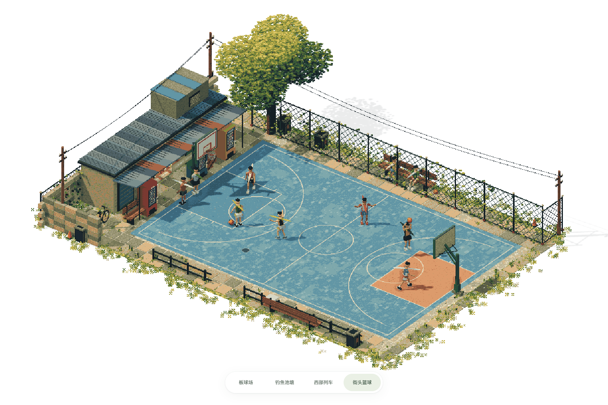
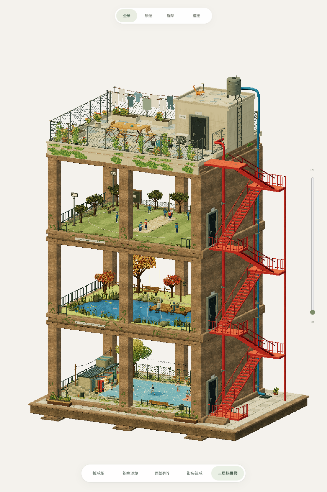
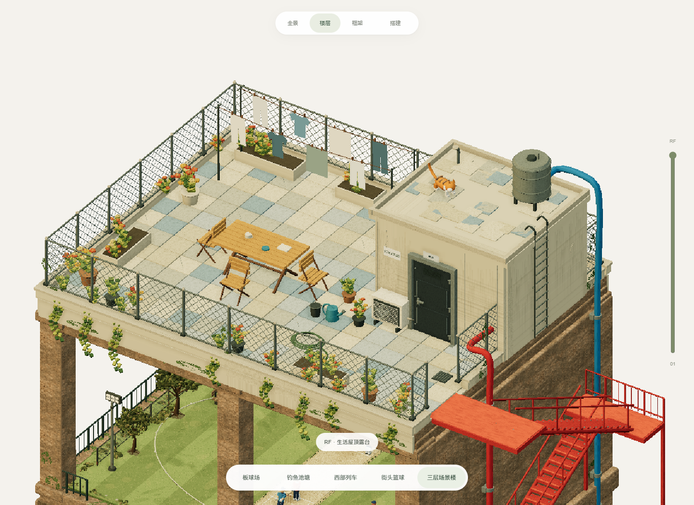

# 像素微缩场景 · Pixel Diorama Collection

[在线浏览三层场景楼](https://luoban25.github.io/pixel-diorama-collection/?scene=tower) · [街头篮球](https://luoban25.github.io/pixel-diorama-collection/?scene=basketball) · [全部场景](https://luoban25.github.io/pixel-diorama-collection/) · [浏览器在线开发](https://codespaces.new/luoban25/pixel-diorama-collection?ref=main)

[直接查看生活屋顶露台](https://luoban25.github.io/pixel-diorama-collection/?scene=tower&floor=roof)：水泥小房、铁丝围栏、晾衣绳、木桌椅、花盆藤蔓、空调、水箱、爬梯与橘白小猫。衣物和小猫有轻微循环动作，屋顶模式使用较高的固定正交视角。

四个独立保存的 Three.js 等距微缩场景，加上一栋复用原场景的三层楼。固定正交相机，底部切换场景。

- **三层场景楼**：从下至上为街头篮球、秋日池塘、板球场；厚石框架、自然苔藓、红色双跑楼梯、贯通侧墙、各层铁门及红蓝管线。支持全景、逐层查看、框架和搭建进度。

- **街头篮球**：旧蓝色球场、街角商店与贩卖机、树木、铁丝围栏和由像素 X 簇拥渐隐的边缘。六名球员服装各异，两边交替运球、起跳投篮、接球与反弹回传，配合接应跑动和防守移动；四位观众有独立休闲穿搭。
- **西部列车**：红岩荒漠、石拱、木桥峡谷、蒸汽列车、六名奔马骑手、风车和水塔；12 秒循环动画。
- **钓鱼池塘**：秋色树木、蓝色池水、游鱼与涟漪，两名人物每隔 3 秒触发钓鱼动作。
- **板球场**：条纹草坪、球场、球员、围栏、树木、灯架与木制看台。







## 直接打开

GitHub Pages 上可直接浏览，无需登录。也可以下载仓库中的 `index.html`，在支持 WebGL 2 的现代浏览器中打开；所有场景、纹理和 Three.js 代码均已内嵌，离线可用。

独立页面位于 `scenes/tower/`、`scenes/cricket/`、`scenes/pond/`、`scenes/western/`、`scenes/basketball/`。使用 `?scene=tower`、`?scene=western`、`?scene=pond`、`?scene=cricket`、`?scene=basketball` 可直接选择项目。

## 浏览器在线开发

1. 打开 [GitHub Codespaces 开发入口](https://codespaces.new/luoban25/pixel-diorama-collection?ref=main)，登录自己的 GitHub 账号并创建工作环境。
2. 环境会安装依赖、启动开发服务并转发 **5319** 端口。在 Ports 面板打开“场景预览”，网址后加 `?scene=tower` 查看三层楼。
3. 修改 `projects/tower/src/` 中的源码并保存，预览会自动构建、刷新。其他场景分别在 `projects/` 对应目录。
4. 在 Source Control 中提交并推送；更新进入 `main` 后，GitHub Actions 会自动构建并发布到 Pages。通过仓库的 Actions 查看发布进度。

轻量编辑可用 [github.dev 网页编辑器](https://github.dev/luoban25/pixel-diorama-collection)，它适合改源码和提交；运行、构建及预览使用 Codespaces。第一次创建 Codespace 需要使用者自己的账号；是否可创建和额度以账号设置为准。

如果环境恢复后预览没有启动，在终端运行 `npm run dev`。更改 `build.cjs` 后需要重启开发服务。

## 源码与重建

需要 Node.js 22 或更新版本：

```sh
npm ci
npm run build
npm run dev
```

构建会更新自包含的根页面和五个独立页面。`npm run dev` 同时监听源码变化并自动构建、刷新；`npm start` 只提供静态预览。GitHub Actions 会在 `main` 更新后自动运行 `npm ci`、构建并发布 `_site/`，因此在线修改源码后无需手工上传生成页面。

- `projects/cricket/src/`：板球场。
- `projects/tower/src/`：楼体、粗石框架、门、楼梯、管线、苔藓以及原项目复用；详见 [楼体说明](projects/tower/README.md)。
- `projects/pond/src/`：秋色钓鱼池塘。
- `projects/western/src/`：西部列车、地貌与骑手。
- `projects/basketball/src/`：街头篮球、碎边地表、商店、树木与人物。
- `src/gallery.html`、`src/scene-shell.html`：极简切换页面与渲染器模板。

未激活的场景停止动画；适配窄屏，并遵循系统减少动态效果偏好。

## 来源

场景几何由程序生成；楼体石材使用 [Poly Haven Rock 04](https://polyhaven.com/a/rock_04)（Rob Tuytel，CC0）的内嵌贴图，其余纹理由程序生成。Three.js r180 使用 MIT 许可，许可随构建页面内嵌，并保留于 [THIRD_PARTY_LICENSES.txt](THIRD_PARTY_LICENSES.txt)。渲染技术参考与视觉来源见 [SOURCES.md](SOURCES.md)。参考图片未打包进仓库。
